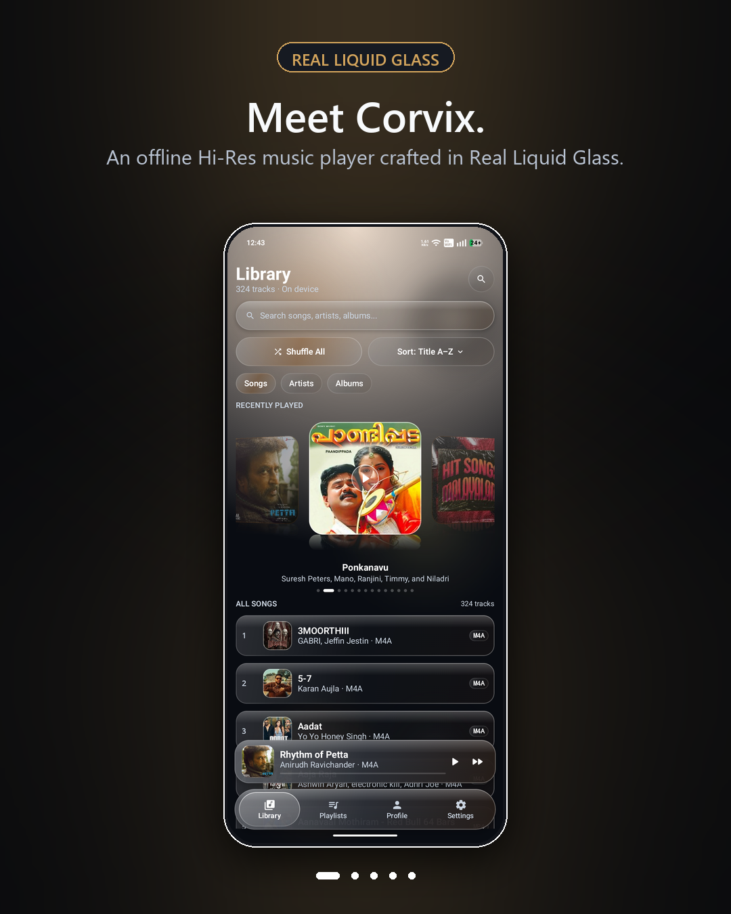
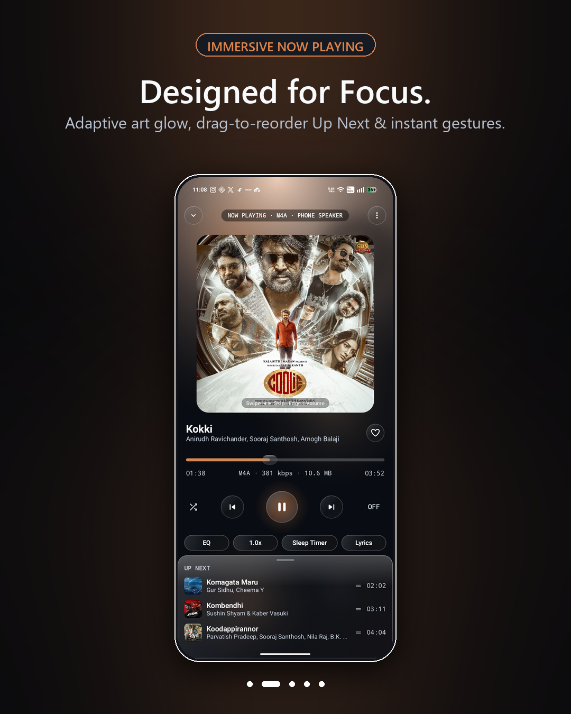
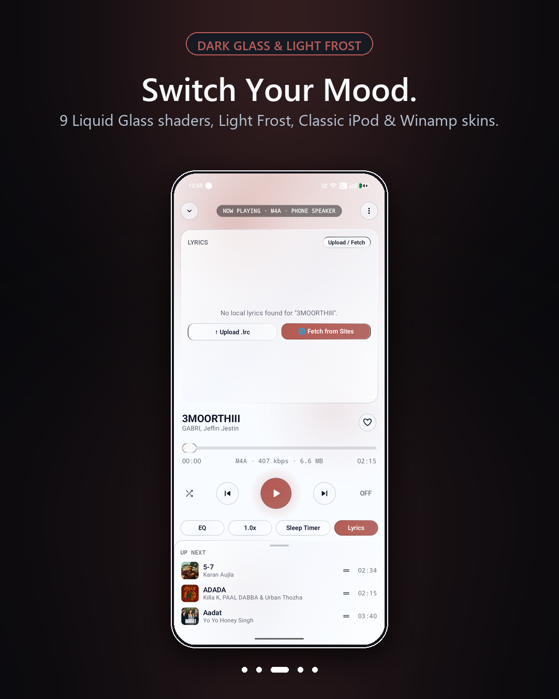
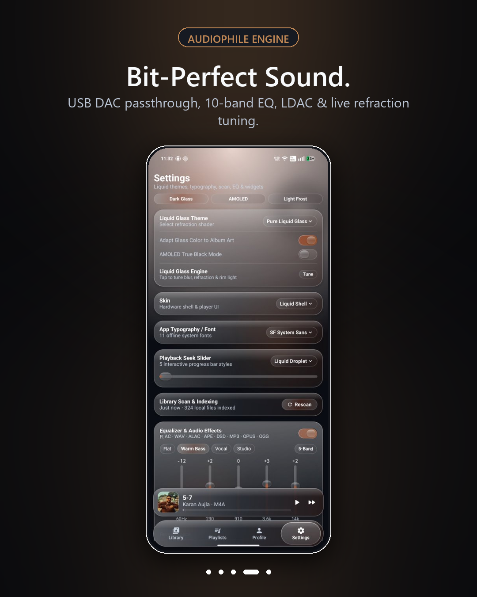
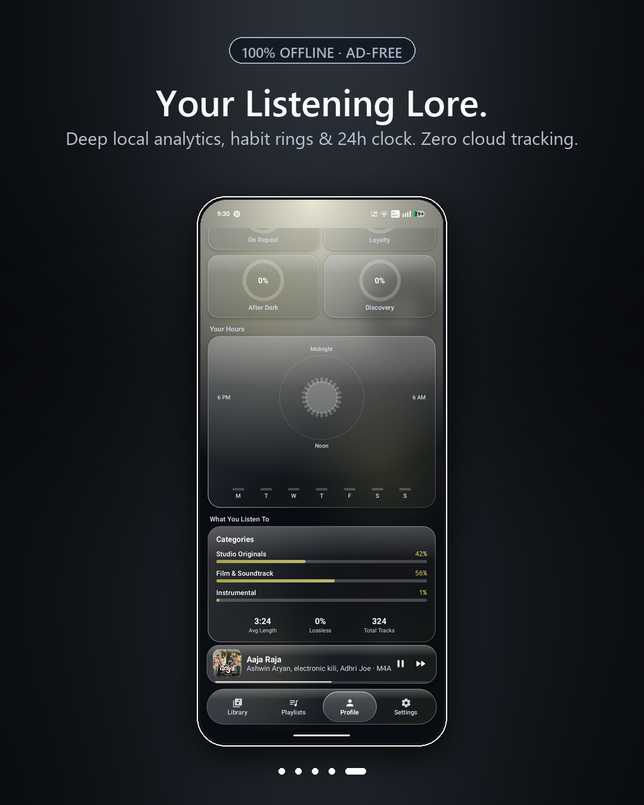

<div align="center">
  
  <h1>Corvix</h1>
  <p><strong>Offline Lossless Android Music Player · Liquid Glass UI, Hardware DSP &amp; Retro Skins</strong></p>

  <p>
    <a href="https://github.com/ravenshadex/Corvix/releases/latest">
      
    </a>
    
    
    
    
  </p>

  <p>
    <a href="https://github.com/ravenshadex/Corvix/releases"><strong>Releases &amp; APKs</strong></a> ·
    <a href="CHANGELOG.md"><strong>Changelog</strong></a> ·
    <a href="#features"><strong>Features</strong></a> ·
    <a href="#build-from-source"><strong>Build from Source</strong></a>
  </p>
</div>

---

## Showcase

| Library & Liquid Glass | Now Playing & Controls | Themes & Skins | Audio DSP & Equalizer | Listening Recap |
| :---: | :---: | :---: | :---: | :---: |
|  |  |  |  |  |

---

## Features

### Skins, Liquid Glass & Visual Customization
- **3 Switchable App Skins (`AppSkin`):**
  - **Liquid Shell** — Floating glass dock, adaptive album-color ambient orbs, and specular glass surfaces
  - **Classic iPod** — 7th-gen metallic Click Wheel & split-screen classic iPod browser
  - **Winamp Classic** — 2.91 3-window rack with 10-band EQ and terminal playlist
- **9 Glass Theme Presets + 3 Glass Tones:** Pure Liquid Glass, Frost Liquid Glass, Mercury Liquid, Aurora Gel, Prism Crystal, Obsidian Smoke, Neon Cyber Glass, Sakura Silk, and Midnight Velvet across **Dark Glass**, **AMOLED**, and **Light Frost**
- **11 Offline System Fonts (`AppTypography`):** SF System Sans, SF Rounded, Geometric Humanist, Editorial Serif, Classic Book Serif, Studio Mono, Condensed Display, iPod Swiss, Typewriter Slab, Modern Wide, Clean Thin
- **Home Screen Widgets:** Liquid Glass and Winamp Classic interactive Android widgets (`Glance` / `AppWidgetProvider`)

### Smart Offline Library, Queue & Search
- **MediaStore Local Audio Scanner:** Indexes on-device FLAC, WAV, ALAC, APE, DSD, MP3, OPUS, OGG, and M4A tracks by songs, artists (ID3), albums (ID3), genres, and folders
- **7-Language Automatic Detection:** Recognizes English, Malayalam, Tamil, Hindi, Telugu, Japanese, and Korean tracks
- **Smooth Multi-Token Search:** Search across title, artist, album, genre, codec format, and language with title-prefix relevance ranking, lively animated border shimmer, cycling search hints, live match counter badge, and smooth result transitions
- **Queue & Up Next:** Add to Queue, Play Next, drag-to-reorder upcoming tracks, and shuffle/repeat (`OFF`, `ALL`, `1`) with service-level background queue fallback

### Now Playing, Lyrics & Visualizers
- **5 Interactive Seek Bar Styles:** Liquid Droplet, Audio Waveform, Minimal Line, Segmented Blocks, Vinyl Groove
- **11 Real-Time Visualizers:** Spectrum Bars, Mirror Pulse, Sine Waveform, Orbit Ring, Particle Drift, LED Matrix, Aurora Ribbon, VU Meters, Water Ripples, Dotted Equalizer, Neon Horizon
- **Synced Lyrics & Tag Editor:** Local `.lrc` loading, online lyrics & cover-art fetchers, offline tag editing, and shareable PNG song cards

### Audio Engine, DSP & Hardware Controls
- **Media3 ExoPlayer & Foreground `MediaSessionService`:** Reliable background playback with local CPU wake lock (`C.WAKE_MODE_LOCAL`), error auto-recovery, and persistent notification playback controls (`Previous`, `Play/Pause`, `Next`)
- **Hardware Audio DSP (`CorvixDspEngine`):** Built on Android `Equalizer` (5-band & 10-band), `BassBoost`, `Virtualizer`, and `PresetReverb` (Room, Hall, Cathedral, Plate), plus presets (`Flat`, `Warm Bass`, `Vocal`, `Studio`) and AutoEQ profiles (Sony WH-1000XM5, Sennheiser HD 650, Moondrop Blessing 3, AirPods Pro 2)
- **Output & Headset Intelligence:** Automatic detection of USB DACs, wired IEMs, and Bluetooth codecs (`LDAC`, `aptX HD`, `AAC`, `SBC`); multi-tap headset hook controls (1 tap = Play/Pause, 2 taps = Next, 3 taps = Previous); automatic playback pause when external voice recorders or active mic capture starts

### Utilities & Stats
- **Listening Recap (`ProfileScreen`):** Play counts, top artists, top tracks, language breakdown, and listening habits
- **Offline Ringtone Cutter & Smart LPF Sleep Timer**

---

## Tech Stack

| Layer | Technology |
| :--- | :--- |
| **Language** | Kotlin `2.0.21` (JVM 17) |
| **UI Framework** | Jetpack Compose `1.7.0`, Material 3 `1.3.0`, Material Icons Extended |
| **Audio Playback** | AndroidX Media3 (`media3-exoplayer`, `media3-session`, `media3-common`) `1.4.1` |
| **Hardware DSP** | `android.media.audiofx` (`Equalizer`, `BassBoost`, `Virtualizer`, `PresetReverb`) |
| **Storage & Prefs** | Android `MediaStore`, `DataStore Preferences 1.1.1`, `DocumentFile 1.0.1` |
| **Android SDK** | `minSdk 26` (Android 8.0) · `targetSdk 34` · `compileSdk 34` |

---

## Project Structure

```text
Corvix/
├── app/
│   ├── build.gradle.kts                 # App config, dependencies, versionCode / versionName
│   └── src/
│       ├── main/
│       │   ├── AndroidManifest.xml      # Permissions, MainActivity, CorvixPlaybackService, widgets
│       │   └── java/com/corvix/player/
│       │       ├── audio/               # ExoPlayer MediaSessionService, DSP engine, scanner, lyrics/art fetchers
│       │       ├── model/               # Skins, presets, Track models, LRC parser, transliteration
│       │       ├── ui/                  # Compose screens, Liquid Glass components, iPod & Winamp skins
│       │       ├── viewmodel/           # CorvixViewModel state, queue, search & playback coordination
│       │       └── widget/              # Liquid Glass & Winamp Classic home-screen widgets
│       └── test/                        # JVM unit tests (CorvixModelsTest)
├── promo_carousel/                      # Showcase visuals
├── skins/winamp_classic/                # Winamp skin preview & manifest
├── CHANGELOG.md                         # Version release history & patch notes
└── build.gradle.kts / settings.gradle.kts
```

---

## Download & Install

Grab the latest pre-built universal APK from [**GitHub Releases**](https://github.com/ravenshadex/Corvix/releases/latest) and install it on any Android `8.0+` device.

---

## Build from Source

```bash
git clone https://github.com/ravenshadex/Corvix.git
cd Corvix

# Run unit tests
./gradlew testDebugUnitTest

# Build installable APK
./gradlew assembleDebug
```

On Windows PowerShell:

```powershell
.\gradlew.bat testDebugUnitTest assembleDebug
```

The generated APK is output to `app/build/outputs/apk/debug/app-debug.apk`.
